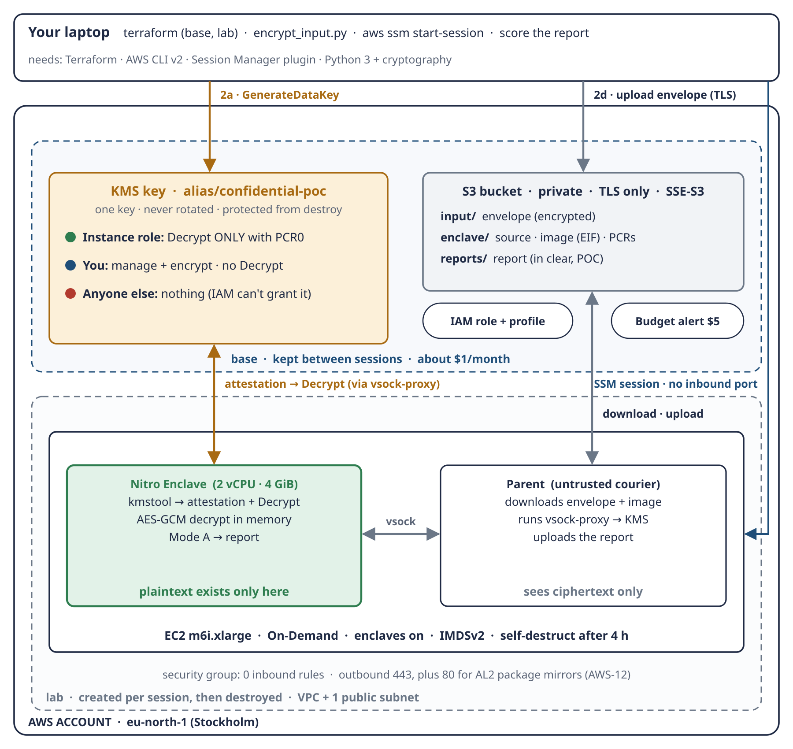
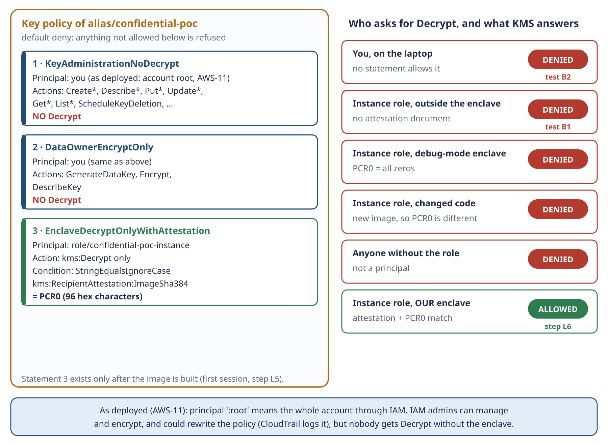
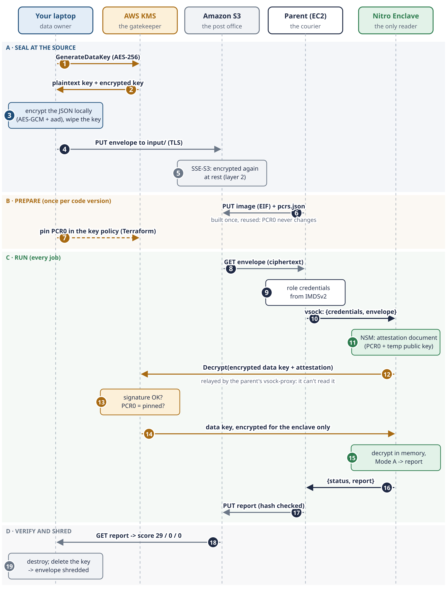

# Confidential Data Processing on AWS

**The goal:** process sensitive data so that it is **readable only inside a verified, short-lived, isolated environment** (an AWS Nitro Enclave), and **nothing usable is left behind**.

This repository takes that idea from the design all the way to a real run on AWS. The test case is realistic but **entirely synthetic**: reconciling six months of payslips for 100 employees, with simplified Italian payroll rules.

> **Golden rule:** *don't trust the place, verify the code.*
> **In one sentence:** *the parent instance is a courier, the enclave is the only reader, and KMS is the gatekeeper.*



---

## How it works, in short

1. The payslips are **encrypted on the laptop** before they ever reach AWS, and they sit in S3 only as ciphertext.
2. A short-lived EC2 instance downloads them, but **it can't read them**. It hands them to a Nitro Enclave over vsock, the enclave's only connection to the outside.
3. The enclave asks KMS to unlock the data key and **proves which code it is running**: a document signed by the Nitro hardware, carrying the fingerprint of the image (PCR0).
4. KMS compares that fingerprint with the one pinned in the key policy. Only if they match does it hand over the data key, sealed so that only the enclave can open it.
5. The enclave decrypts the payslips, recomputes every one of them and reports the differences.
6. When the job is done, the instance is destroyed. The enclave never had a disk, so no readable copy stays behind.

---

## Where it stands

| | |
|---|---|
| **Design** | complete: study guide, specification, 12 diagrams, and every decision recorded with its reason |
| **Code** | complete and tested: 70 Python tests, 4 offline Terraform tests, and the enclave image built and run locally |
| **First run on AWS** | deployed in Stockholm; the job ran **inside a real Nitro Enclave**|
| **Today** | no AWS resources and no running cost. The KMS key was scheduled for deletion right after the run, which makes the encrypted copies unreadable for good |
| **Still to capture** | the first run didn't record the status line, tests B1/B2 or the score; the next run will, as the formal proof |
| **Before real data** | five gaps to close (F1–F5): sealed output, a reproducible build linked to the source, split key administration, a signed report and an expected dataset. See [poc/README.md](poc/README.md#future-implementation-gaps-to-close-before-real-data) |

---

## Where to start

| # | Read | What you get |
|---|---|---|
| 1 | **[confidential-poc-handbook.docx](confidential-poc-handbook.docx)** | the whole project in one place: what was built, why, and how it works in depth |
| 2 | [confidential-processing-aws-study-guide-v2.docx](confidential-processing-aws-study-guide-v2.docx) | the big picture and the 10 key concepts, with diagrams |
| 3 | [poc-tier1-spec.docx](poc-tier1-spec.docx) | the exact design that was deployed: architecture, key policy, enclave, runbook |
| 4 | [poc/README.md](poc/README.md) | **every decision** (DATA-1..7, AWS-1..12, IMPL-1..8) and the reason behind it |
| 5 | [poc/procedures/](poc/procedures/) | step-by-step guides to run it yourself |

---

## What's in the repository

### Documents

| File | Content |
|---|---|
| [confidential-poc-handbook.docx](confidential-poc-handbook.docx) | the handbook: the whole project, end to end |
| [confidential-processing-aws-study-guide-v2.docx](confidential-processing-aws-study-guide-v2.docx) | the guide: Part I the big picture, Part II the original build plan (what was built is in the spec), Part III review notes and glossary |
| [payslip-poc-data-dictionary.docx](payslip-poc-data-dictionary.docx) | the payslip fields, the formulas and the planted errors |
| [poc-deployment-paths-ec2-vs-eks.docx](poc-deployment-paths-ec2-vs-eks.docx) | Tier 1 (EC2) against Tier 2 (EKS): the differences and the costs in Stockholm |
| [poc-tier1-spec.docx](poc-tier1-spec.docx) | the design specification of the deployed POC |
| [poc/procedures/Base-phase-terraform.docx](poc/procedures/Base-phase-terraform.docx) | procedure, base phase: Terraform, encrypt and upload, test B2 |
| [poc/procedures/Lab-phase-terraform.docx](poc/procedures/Lab-phase-terraform.docx) | procedure, lab phase: instance, enclave image, PCR0, job, tests, destroy |

The documents and diagrams are generated by scripts that aren't part of this repository; the .docx files and `schemas/` are their published output.

### Folders

| Folder | Content |
|---|---|
| [poc/](poc/) | the proof of concept: the [decision log](poc/README.md), the code and the procedures |
| [poc/payslip/](poc/payslip/) | the payroll formulas (`payroll_rules.py`), the reconciliation (`reconcile.py`), the dataset generator, the envelope format (`envelope.py`), the encryption (`encrypt_input.py`) and the scoring (`score_report.py`), with 47 tests |
| [poc/enclave/](poc/enclave/) | the enclave app (`enclave_app.py`), the vsock framing, the parent runner (`run_job.py`, `run_job.sh`), the `Dockerfile`, `build_enclave.sh` and `upload_enclave_src.sh`, with 23 tests |
| [infra/base/](infra/base/) | the Terraform that stays between runs: KMS key, S3 bucket, IAM role and budget, with [offline tests](infra/base/tests/pcr0_guard.tftest.hcl) |
| [infra/lab/](infra/lab/) | the Terraform created for each run: VPC, security group, and the EC2 parent with enclaves enabled ([startup script](infra/lab/user-data.sh.tftpl)) |
| [data/](data/) | the synthetic [payslips](data/payslips-2026-H1.json) and the [answer key](data/answer-key-2026-H1.json), which never goes to S3 or to the enclave |
| [schemas/](schemas/) | the 12 diagrams, as SVG source and PNG |

---

## The key ideas

### 1. Three locks, and only a real enclave holds all three

KMS releases the data key only when three checks pass at the same time.

| Lock | What KMS checks | Who can pass it |
|---|---|---|
| **Identity** | the caller is allowed by the key policy | the instance role |
| **Attestation** | a document **signed by the Nitro hardware** | only code running in a real enclave |
| **PCR0** | the image fingerprint matches the pinned one | only **this** enclave image |

*Credentials say who you are, attestation proves where you run, PCR0 proves what you run.*

### 2. Nobody but the enclave can decrypt

| Who | Can | Can't |
|---|---|---|
| The key admin | manage the key | **Decrypt** |
| The data owner | GenerateDataKey, Encrypt | **Decrypt** |
| The instance role | **Decrypt, only with an attestation showing the pinned PCR0** | anything else |

In the first run both human roles were held by the account root (decision AWS-11). Either way, nobody gets Decrypt outside the enclave.



### 3. Two layers of encryption

- **The envelope:** the payslips are encrypted **on the laptop** with a KMS data key (AES-256-GCM, bound to the dataset id). Only the attested enclave can unlock that key.
- **At rest:** S3 encrypts the object a second time (SSE-S3). That only protects the disks inside AWS.

*KMS Encrypt takes at most about 4 KB, so larger data always goes through a data key: that's envelope encryption.*

### 4. Ciphertext in, ciphertext out

The enclave has no disk and no network; its only door is vsock to the parent. **S3 is the post office, the parent is the courier, and the enclave is the only reader.** Anything that can be linked to a person should leave the enclave encrypted. In this POC the report leaves in clear, because the data is synthetic (decision AWS-8).

### 5. Build once, and PCR0 never changes

The enclave image is built once and kept in S3. The same bytes always give the same PCR0, so the key policy never has to change. Alter one byte and the PCR0 changes, and KMS says no. **Only a trusted admin pins PCR0, never the instance itself.**

### 6. Two Terraform stacks: base and lab

| | base | lab |
|---|---|---|
| Lifetime | created once and kept | created for each run, then destroyed |
| Contents | KMS key, S3 bucket, IAM role, budget | VPC, security group (nothing inbound; 443 and 80 outbound), EC2 m6i.xlarge with enclaves |
| Cost | about $1 a month | $0.204 an hour |

Three safety nets keep the bill small: `terraform destroy` after each run, a **self-destruct after 4 hours**, and a **$5 budget alert**.

### 7. The whole flow in eight words

**Build, Measure, Pin**, once per code version. Then **In, Prove, Process, Out, Shred**, for every job.



---

## How we know it works

| Test | Passes when |
|---|---|
| **A** | the enclave decrypts the payslips, runs the reconciliation, and the report scores **29 matched, 0 missed, 0 unexpected** |
| **B1** | the instance tries Decrypt on its own, outside the enclave, and gets **AccessDenied** |
| **B2** | you try Decrypt from your laptop and get **AccessDenied** |
| **C** | the report lands in the private bucket (in clear, in this POC) |
| **D** | after `terraform destroy`, nothing is left |

---

## Run it

```bash
# local tests (free)
(cd poc/payslip && python3 -m unittest)          # 47 tests
(cd poc/enclave && python3 -m unittest)          # 23 tests, including the local dry run 29 / 0 / 0
terraform -chdir=infra/base init && terraform -chdir=infra/base test   # 4 offline tests (mock AWS)

# on AWS: follow the procedures, in this order
#   poc/procedures/Base-phase-terraform.docx   (about 30–45 minutes, ~$1 a month)
#   poc/procedures/Lab-phase-terraform.docx    (first run about 1.5–2 hours, ~$0.45)
```

---

## How it was made

The architecture is mine. I chose the pattern, the AWS services and the trade-offs, and I signed off every decision in [poc/README.md](poc/README.md).

I built it with Claude, Anthropic's AI assistant, as a co-author. Claude helped turn those decisions into the code, the Terraform, the tests, the documents and the diagrams, and explained every step along the way so I could follow and check it. That's why the commits carry a `Co-Authored-By: Claude` line.

---

## License

- **Code** (`poc/`, `infra/`): [MIT](LICENSE).
- **Documents, diagrams and the synthetic dataset** (`*.docx`, `schemas/`, `data/`, the markdown files): [CC BY 4.0](LICENSE-docs.md).
